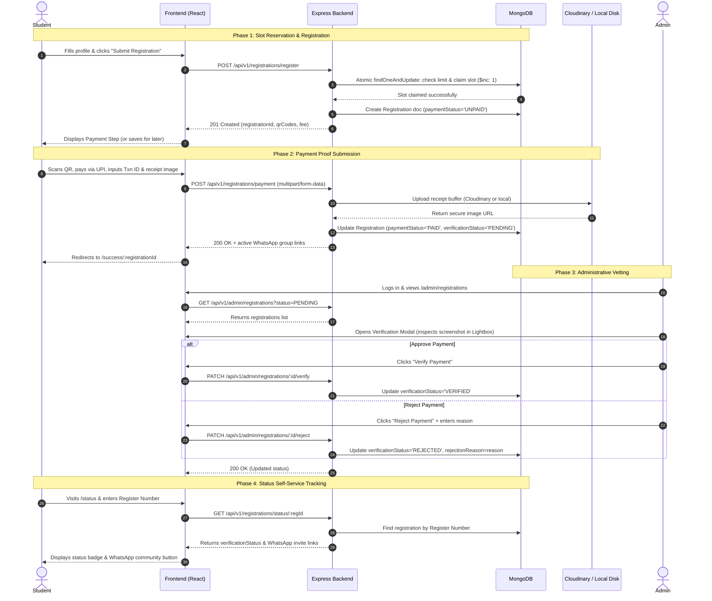

# AgriGen Event Registration & Payment Verification Platform
### Complete Architecture, Technical Blueprint & System Workflow Guide

> **Note for Developers & Builders**: This documentation serves as the comprehensive, authoritative specification and system blueprint of the platform. If you are developing a new website or reimagining this platform, this document outlines every workflow, database schema, API endpoint, concurrency safety measure, and UI/UX state implemented in this production codebase.

---

## 📑 Table of Contents
1. [Executive Summary & Purpose](#1-executive-summary--purpose)
2. [High-Level Architecture & Tech Stack](#2-high-level-architecture--tech-stack)
3. [End-to-End User & Admin Workflows](#3-end-to-end-user--admin-workflows)
   - [Workflow A: Student Registration Flow](#workflow-a-student-registration-flow)
   - [Workflow B: Payment & Proof Submission Flow](#workflow-b-payment--proof-submission-flow)
   - [Workflow C: "Pay Later" / Deferred Payment Portal](#workflow-c-pay-later--deferred-payment-portal)
   - [Workflow D: Student Status Lookup & Passport](#workflow-d-student-status-lookup--passport)
   - [Workflow E: Admin Vetting & Verification Pipeline](#workflow-e-admin-vetting--verification-pipeline)
   - [Workflow F: Event Settings, QR & WhatsApp Group Management](#workflow-f-event-settings-qr--whatsapp-group-management)
   - [Workflow G: Automated Excel Export Pipeline](#workflow-g-automated-excel-export-pipeline)
4. [Database Schemas & Data Dictionary](#4-database-schemas--data-dictionary)
   - [Registration Schema](#registration-schema)
   - [EventSettings Schema](#eventsettings-schema)
   - [Admin Schema](#admin-schema)
5. [Complete API Reference](#5-complete-api-reference)
   - [Public Endpoints](#public-endpoints)
   - [Admin Endpoints (JWT Protected)](#admin-endpoints-jwt-protected)
   - [System Health & Diagnostics](#system-health--diagnostics)
6. [Frontend Structure & UI Architecture](#6-frontend-structure--ui-architecture)
   - [Routing Table](#routing-table)
   - [Page Breakdown & Behavior](#page-breakdown--behavior)
   - [UI Component Hierarchy & Layout Guidelines](#ui-component-hierarchy--layout-guidelines)
7. [Advanced Engineering Features](#7-advanced-engineering-features)
   - [Atomic Concurrency Control (Zero Overselling)](#atomic-concurrency-control-zero-overselling)
   - [Client-Side Round-Robin Load Balancing & Failover](#client-side-round-robin-load-balancing--failover)
   - [Hybrid Cloud Storage with Automatic Local Fallback](#hybrid-cloud-storage-with-automatic-local-fallback)
   - [Pre-flight Real-Time Availability Validation](#pre-flight-real-time-availability-validation)
   - [Form Auto-Recovery & Draft Preservation](#form-auto-recovery--draft-preservation)
8. [Environment Setup & Deployment Guide](#8-environment-setup--deployment-guide)
   - [Backend Environment Variables (`.env`)](#backend-environment-variables-env)
   - [Frontend Environment Variables (`.env`)](#frontend-environment-variables-env)
   - [Local Development Walkthrough](#local-development-walkthrough)
   - [Production Deployment (Vercel / VPS / Cloud)](#production-deployment-vercel--vps--cloud)
9. [Blueprint Checklist for Building the New Website](#9-blueprint-checklist-for-building-the-new-website)

---

## 1. Executive Summary & Purpose

The **AgriGen Platform** is a specialized, production-hardened web application designed to handle high-traffic student registrations, seat-capacity enforcement, multi-channel payment proof collection, manual administrative vetting, and student self-service status verification.

### Core Problems Solved:
1. **High-Concurrency Traffic Bursts**: College and university events experience massive spikes of hundreds of registrations per minute as soon as links are posted in student groups. The platform employs atomic database seat counters to prevent overbooking past the maximum limit.
2. **Duplicate Prevention**: Immediate verification stops duplicate enrollments using student Register Numbers, academic emails, or reused UPI transaction IDs.
3. **Decoupled Registration vs. Payment ("Pay Later" Model)**: Students can lock in their registration slot immediately even if their UPI app is lagging, and upload their payment proof later through a dedicated lookup portal.
4. **Fraud-Resistant Manual Verification**: Rather than relying on fragile direct UPI webhooks that fail on campus networks, students upload their transaction screenshot and reference ID. Administrators inspect screenshots in a high-res lightbox viewer before approving or rejecting.
5. **Community Onboarding**: Verified and pending students receive dynamically configured official WhatsApp group community links based on administrator settings.

---

## 2. High-Level Architecture & Tech Stack

```
┌────────────────────────────────────────────────────────────────────────┐
│                          CLIENT LAYER (BROWSER)                        │
│  React 18 + Vite SPA | Tailwind CSS | Lucide Icons                     │
│  Axios Client with Dynamic Round-Robin & Auto-Failover Engine          │
└─────────────────────────────────┬──────────────────────────────────────┘
                                  │ HTTP / REST / Multipart Form
                                  ▼
┌────────────────────────────────────────────────────────────────────────┐
│                        API LOAD BALANCING & GATEWAY                    │
│  Configurable Multi-Endpoint Round-Robin (e.g. Primary + Replica Nodes)│
│  Automatic 5xx/Timeout Retry on Backup Server                          │
└─────────────────────────────────┬──────────────────────────────────────┘
                                  │
                                  ▼
┌────────────────────────────────────────────────────────────────────────┐
│                      BACKEND SERVER (Node.js / Express)                │
│  - Helmet Security & Strict CORS Policy                                │
│  - In-Memory Response Caching (1.5s - 3s TTL to protect DB)            │
│  - Multer Memory Buffer Processing (up to 10MB JPG/PNG/WEBP)           │
│  - JWT Bearer Authentication & Bcrypt Password Hashing                 │
│  - ExcelJS Streaming Workbook Generation Engine                        │
└───────────────────┬──────────────────────────────────┬─────────────────┘
                    │                                  │
                    ▼                                  ▼
┌──────────────────────────────────────┐   ┌─────────────────────────────┐
│       DATABASE (MongoDB / Mongoose)   │   │     MEDIA & PROOF STORAGE   │
│  - Unique Indexes on RegNo & TxnId   │   │  - Primary: Cloudinary CDN  │
│  - Atomic $expr Seat Allotment Gate  │   │  - Auto-Fallback: Local Disk│
│  - Mongoose Validation Hooks         │   │    (/public/uploads)        │
└──────────────────────────────────────┘   └─────────────────────────────┘
```

### Technology Breakdown
- **Frontend**:
  - **Framework**: [React 18](https://react.dev/) using Vite 6.
  - **Routing**: [React Router DOM v6](https://reactrouter.com/) (Public layout, Protected Admin Layout with nested routes).
  - **Styling**: [Tailwind CSS v3](https://tailwindcss.com/) utility framework for modular component styling.
  - **Icons**: [Lucide React](https://lucide.dev/) + custom vector SVG icons (`AgrigenIcons.jsx`).
  - **HTTP Client**: [Axios](https://axios-http.com/) with custom request/response interceptors for multi-host Round-Robin load distribution and auto-failover.
- **Backend**:
  - **Runtime**: [Node.js](https://nodejs.org/) (ES Modules `import/export`).
  - **Framework**: [Express.js v4](https://expressjs.com/).
  - **Database ODM**: [Mongoose v8](https://mongoosejs.com/) on MongoDB.
  - **File Uploads**: [Multer](https://github.com/expressjs/multer) with memory storage buffer parsing.
  - **Image Hosting**: [Cloudinary SDK v1](https://cloudinary.com/) with automatic local filesystem fallback.
  - **Excel Export**: [ExcelJS v4](https://github.com/exceljs/exceljs) (generates styled `.xlsx` spreadsheets).
  - **Security**: [Helmet](https://helmetjs.github.io/), [cors](https://github.com/expressjs/cors), [bcryptjs](https://github.com/dcodeIO/bcrypt.js), [jsonwebtoken](https://github.com/auth0/node-jsonwebtoken).

---

## 3. End-to-End User & Admin Workflows

### System Interaction Diagram



---

### Workflow A: Student Registration Flow
1. **Landing Page (`/`)**:
   - The user views event headlines, description, live seat capacity meter (`X / Y Slots Booked`), registration fee, and CTA buttons.
   - When the user clicks **"Register Now"**, the frontend sends a pre-flight request to `GET /api/v1/event/status`.
   - If registrations are closed or capacity is filled, a clear modal/banner informs the student and halts progression.
2. **Registration Page (`/agrigenevent/registerationforstudent`)**:
   - The student fills in the mandatory individual profile details:
     - **Full Name** (text)
     - **Register / Roll Number** (unique, auto-uppercased)
     - **Academic Email Address** (valid email format, unique)
     - **Phone Number** (10-digit format)
     - **Department** (dropdown or text: e.g. CSE, IT, AI&DS, ECE, MECH, etc.)
     - **Section** (single uppercase character or label: e.g. A, B, C)
     - **Academic Year** (1st Year, 2nd Year, 3rd Year, 4th Year, Other)
     - **Gender** (Male, Female, Other)
     - **Residency Status** (`Day Scholar` or `Hosteller`)
3. **Real-Time Client-Side & Debounced Validation**:
   - As the student inputs their Register Number, Email, and Phone, debounced requests to `POST /api/v1/registrations/check` verify in the background if the credentials have already been registered.
   - Real-time badges indicate availability (`Available ✓` or `Already Registered ✕`).
4. **Draft Autosave**:
   - All input changes are synced to browser `localStorage` (`agrigen_solo_registration_draft_v4`). If the user accidentally refreshes or navigates away, form values are restored seamlessly.
5. **Submission & Atomic Slot Claim**:
   - Submitting the form calls `POST /api/v1/registrations/register`.
   - The backend atomically increments `currentRegistrations` in `EventSettings` if and only if `currentRegistrations < registrationLimit`.
   - If the seat limit is reached simultaneously by another participant, the request receives a `403 Forbidden` response and does not corrupt database counts.
   - A new document is saved in the `Registration` collection with:
     - `paymentStatus: "UNPAID"`
     - `verificationStatus: "PENDING"`
     - `registrationId: registerNumber`
   - The draft is cleared, and the UI transitions immediately into **Step 2 (Payment Screen)** without reloading.

---

### Workflow B: Payment & Proof Submission Flow
1. **QR Code Display**:
   - The system retrieves active UPI QR codes from the server.
   - Each QR code item displays the QR image, Title (e.g. "Primary UPI QR"), and UPI ID (with a one-click copy button).
   - If multiple QR codes are configured by the admin, tabs allow students to switch between them.
2. **Payment Execution**:
   - The student opens any UPI application (Google Pay, PhonePe, Paytm, BHIM) on their mobile device, scans the displayed QR code, and transfers the exact registration fee.
3. **Proof Collection**:
   - The student inputs:
     - **UPI Reference ID / Transaction ID** (min 4 characters, unique across all registrations).
     - **Payment Screenshot**: File upload input accepting `.jpg`, `.png`, `.jpeg`, `.webp` (up to 10MB).
4. **Client-Side Image Preview & Compression**:
   - An immediate preview is rendered with a "Change Image" button.
5. **Backend Processing (`POST /api/v1/registrations/payment`)**:
   - Uploaded buffer is verified with Multer.
   - Cloudinary receives the image buffer stream; if Cloudinary fails or is unconfigured, the file automatically saves to `/public/uploads/payment_screenshots/`.
   - The registration record updates:
     - `paymentStatus = "PAID"`
     - `transactionId = cleanTxnId`
     - `paymentScreenshot = { url, publicId }`
     - `paymentDate = new Date()`
6. **Redirect to Success Page**:
   - The student is routed to `/success/:registrationId` with confirmation badges and links to join the official WhatsApp groups.

---

### Workflow C: "Pay Later" / Deferred Payment Portal
Often, students register during class or on a computer without immediate access to their UPI phone. The platform provides a dedicated portal for deferred payment:

1. **Route (`/team-payment`)**:
   - Accessible via the navigation bar ("Participant Payment" / "Pay Now").
2. **Student Lookup**:
   - Student enters their **Register Number** or **Registration ID**.
   - Frontend calls `POST /api/v1/registrations/lookup-team`.
3. **Contextual Status Handling**:
   - **Scenario 1: Already Paid & Verified**: Displays congratulatory confirmation card and official community links.
   - **Scenario 2: Already Paid & Pending**: Informs student that payment proof is under admin review.
   - **Scenario 3: Unpaid**: Renders the complete Payment Step (active QR codes, fee details, transaction ID field, and screenshot uploader).
4. **Instant Update**:
   - Upon uploading the proof, the record updates to `PAID` and `PENDING`, transitioning to the success view.

---

### Workflow D: Student Status Lookup & Passport
1. **Route (`/status`)**:
   - Self-service portal where any student can check their enrollment status at any time.
2. **Search by Registration ID / Register Number**:
   - Submits query to `GET /api/v1/registrations/status/:registrationId`.
3. **Passport Card Details Rendered**:
   - Full participant identification (Name, Register No, Department, Section, Year, Residency).
   - **Verification Status Badge**:
     - 🟡 **VERIFICATION PENDING**: Screenshot is waiting for administrator review.
     - 🟢 **VERIFIED ✓**: Administrator vetted payment and registration is confirmed.
     - 🔴 **REJECTED**: Administrator flagged an issue (displays the exact `rejectionReason` entered by admin, e.g. *"Transaction ID does not match the screenshot provided"* or *"Screenshot shows incomplete transaction"*).
   - **Official WhatsApp Group Cards**: Direct links allowing the verified student to join participant community groups.

---

### Workflow E: Admin Vetting & Verification Pipeline
1. **Authentication (`/admin/login`)**:
   - Administrator logs in using their email and password.
   - Server returns a signed JWT token valid for 7 days.
   - Token is stored in `localStorage` and attached to all future requests via Axios interceptor `Authorization: Bearer <token>`.
2. **Dashboard (`/admin/dashboard`)**:
   - Real-time stat cards: Total Participants, Paid Count, Unpaid Count, Pending Verification, Verified Count, Rejected Count, Capacity Limit, Remaining Slots.
   - Visual progress bar showing event fill percentage.
   - Quick one-click switch to Open or Close registrations globally.
   - Recent 5 registrations table for rapid auditing.
3. **Registrations Table (`/admin/registrations`)**:
   - Full-text search across Name, Register Number, Email, Phone, Department, Transaction ID.
   - Status Filters: `ALL`, `PAID`, `UNPAID`, `PENDING`, `VERIFIED`, `REJECTED`.
   - Residency Filter: `ALL`, `Hosteler`, `Dayscholar`.
   - Pagination controls (10, 25, 50 records per page).
4. **Verification Lightbox Modal**:
   - Clicking any row opens a comprehensive verification modal:
     - Side-by-side view of the student's profile and entered Transaction ID.
     - Zoomable payment receipt image with click-to-enlarge lightbox modal (`ImageViewerModal.jsx`).
     - **Actions**:
       - **Verify Button**: Calls `PATCH /api/v1/admin/registrations/:id/verify`. Sets `verificationStatus = "VERIFIED"`.
       - **Reject Button**: Opens an inline reason modal. Admin selects or types why the payment was rejected. Calls `PATCH /api/v1/admin/registrations/:id/reject`.
       - **Direct Status Dropdown**: Allows toggling status back to `PENDING` if needed.
5. **Manual Student Management (`/admin/students`)**:
   - Allows administrators to manually insert offline walk-in registrations (`POST /api/v1/admin/students`).
   - Allows administrators to edit misspelled register numbers, names, departments, or phone numbers (`PATCH /api/v1/admin/students/:id`).

---

### Workflow F: Event Settings, QR & WhatsApp Group Management
Located at `/admin/settings`:
1. **General Settings**:
   - Toggle Registration Open / Closed.
   - Modify Max Capacity / Registration Limit (e.g., from 100 to 250).
   - Set Registration Fee in INR (e.g., ₹150, ₹0 for free).
2. **Multiple QR Code Management**:
   - Upload new UPI QR images (single or batch upload up to 10 files).
   - Set custom titles (e.g., "GPay Primary", "PhonePe Backup").
   - Set UPI ID string (for easy one-click copying by students).
   - Toggle individual QR codes active/inactive.
   - Delete QR codes with automated cleanup from Cloudinary or local disk.
3. **WhatsApp Group Management**:
   - Add new community invite links (Name, Invite URL, Priority Order).
   - Edit URL or Group Name.
   - Toggle individual groups active/inactive.
   - Delete groups.

---

### Workflow G: Automated Excel Export Pipeline
1. **Action in Admin Portal**:
   - Admin selects filters (Status: `ALL`, `PAID`, `UNPAID`, `VERIFIED`, `REJECTED`; Residency: `ALL`, `HOSTLERS`, `DAYSCHOLARS`).
   - Clicks **"Export to Excel (.xlsx)"**.
2. **Backend Processing (`GET /api/v1/admin/export/excel`)**:
   - The server queries matching registrations sorted chronologically.
   - Generates a styled Excel workbook using `ExcelJS`:
     - Landscape orientation with frozen top header row.
     - Dark slate styled header row (`#1E293B`) with white bold text.
     - Structured columns: Reg ID, Full Name, Register Number, Residency, Phone, Department, Section, Year, Gender, Payment Status, Verification Status, Transaction ID, Rejection Reason, Registered Date, Verified Date, Payment Proof URL.
     - Thin light borders on all data cells.
   - Streams the workbook directly as a binary response (`application/vnd.openxmlformats-officedocument.spreadsheetml.sheet`).
3. **Browser Download**:
   - The browser automatically triggers download with filename:
     `Team_Registrations_<STATUS>_<RESIDENCY>_<YYYY-MM-DD>.xlsx`.

---

## 4. Database Schemas & Data Dictionary

### Registration Schema
**Mongoose Model**: `Registration` | **Collection**: `registrations`

| Field Name | Type | Constraints / Defaults | Description |
| :--- | :--- | :--- | :--- |
| `registrationId` | `String` | Required, Unique, Indexed | Primary identifier (stores uppercased Register Number) |
| `fullName` | `String` | Required, Trimmed | Participant's full academic name |
| `registerNumber` | `String` | Required, Unique, Uppercase, Indexed | College roll/register number (e.g. `22CS104`) |
| `email` | `String` | Trimmed, Lowercase, Default: `""` | Academic or personal email address |
| `phone` | `String` | Trimmed, Default: `"N/A"` | Contact mobile phone number |
| `department` | `String` | Required, Trimmed | Department branch (e.g. `CSE`, `AI&DS`, `ECE`) |
| `section` | `String` | Required, Uppercase, Trimmed | Class section identifier (e.g. `A`, `B`) |
| `year` | `String` | Required, Trimmed | Academic year (e.g. `3rd Year`) |
| `gender` | `String` | Required, Enum: `["Male", "Female", "Other"]` | Gender of participant |
| `residency` | `String` | Required, Enum: `["Hosteler", "Dayscholar", "Hosteller", "Day Scholar"]`, Default: `"Dayscholar"` | Residency accommodation status |
| `registrationStatus` | `String` | Enum: `["registered", "cancelled"]`, Default: `"registered"` | Lifecycle status |
| `transactionId` | `String` | Uppercase, Trimmed, Unique (Partial Filter) | Banking / UPI Transaction / UTR reference code |
| `paymentScreenshot.url` | `String` | Default: `""` | URL to uploaded receipt image (Cloudinary or `/uploads/...`) |
| `paymentScreenshot.publicId`| `String` | Default: `""` | Storage asset identifier for deletion handling |
| `paymentStatus` | `String` | Enum: `["UNPAID", "PAID"]`, Default: `"UNPAID"`, Indexed | Payment submission status |
| `verificationStatus` | `String` | Enum: `["PENDING", "VERIFIED", "REJECTED"]`, Default: `"PENDING"`, Indexed | Admin audit verdict |
| `paymentDate` | `Date` | Default: `null` | Timestamp when payment proof was uploaded |
| `rejectionReason` | `String` | Default: `""` | Specific reason entered by admin if rejected |
| `registeredAt` | `Date` | Default: `Date.now` | Registration creation timestamp |
| `verifiedAt` | `Date` | Default: `null` | Timestamp when verified or rejected |
| `createdAt` / `updatedAt` | `Date` | Managed by Mongoose `timestamps: true` | Audit timestamps |

#### Key Schema Indexes:
- `{ registerNumber: 1 }` (Unique index)
- `{ registrationId: 1 }` (Unique index)
- `{ transactionId: 1 }` (Unique index with `{ partialFilterExpression: { transactionId: { $type: "string" } } }` so unpaid records with missing transaction IDs do not collide)
- `{ createdAt: -1 }` (Optimized for reverse chronological queries)

---

### EventSettings Schema
**Mongoose Model**: `EventSettings` | **Collection**: `eventsettings`

| Field Name | Type | Defaults | Description |
| :--- | :--- | :--- | :--- |
| `registrationOpen` | `Boolean` | `true` | Master switch to enable or disable registrations |
| `registrationLimit` | `Number` | `100` (Min: 1) | Maximum total allowable participants |
| `currentRegistrations` | `Number` | `0` | Synced count of total enrolled participants |
| `registrationFee` | `Number` | `0` (Min: 0) | Fee amount in INR per participant |
| `qrCode.url` | `String` | `""` | Legacy primary payment QR code URL |
| `qrCode.publicId` | `String` | `""` | Legacy primary payment QR storage ID |
| `qrCodes` | `Array[QRCodeItem]` | `[]` | Dynamic list of active UPI QR codes |
| `whatsappGroups` | `Array[WhatsAppGroup]` | `[]` | Dynamic list of community WhatsApp groups |

#### Sub-Schema: `QRCodeItemSchema`
- `title` (`String`, default: `"UPI QR Code"`): Custom display label.
- `url` (`String`, required): Public image URL.
- `publicId` (`String`): Storage asset identifier.
- `upiId` (`String`): UPI string (e.g. `eventorganizer@oksbi`).
- `active` (`Boolean`, default: `true`): Visibility switch.
- `createdAt` (`Date`, default: `Date.now`).

#### Sub-Schema: `WhatsAppGroupSchema`
- `name` (`String`, required): Group title (e.g., "AgriGen 2026 Official Group #1").
- `url` (`String`, required): Full `https://chat.whatsapp.com/...` invite link.
- `active` (`Boolean`, default: `true`): Whether visible on success/status screens.
- `order` (`Number`, default: `0`): Priority sort order.

---

### Admin Schema
**Mongoose Model**: `Admin` | **Collection**: `admins`

| Field Name | Type | Constraints / Defaults | Description |
| :--- | :--- | :--- | :--- |
| `username` | `String` | Required, Default: `"Admin"` | Display name |
| `email` | `String` | Required, Unique, Lowercase | Admin login credential |
| `password` | `String` | Required, Select: false | Bcrypt hashed password (salt: 10 rounds) |
| `role` | `String` | Default: `"superadmin"` | Access level |

---

## 5. Complete API Reference

Base URL: `/api/v1`

### Public Endpoints

#### 1. Get Event Configuration & Capacity
- **Endpoint**: `GET /api/v1/event/settings`
- **Access**: Public (In-memory cached with 1.5s TTL)
- **Response `200 OK`**:
```json
{
  "success": true,
  "event": {
    "registrationOpen": true,
    "isSystemOpen": true,
    "isFull": false,
    "registrationLimit": 150,
    "registeredTeams": 42,
    "remainingSlots": 108,
    "progressPercent": 28,
    "registrationFee": 150,
    "qrCode": { "url": "https://...", "publicId": "..." },
    "qrCodes": [
      {
        "id": "66f...",
        "title": "Primary UPI QR",
        "url": "https://...",
        "upiId": "treasurer@upi",
        "active": true
      }
    ],
    "whatsappGroups": [
      {
        "id": "66f...",
        "name": "AgriGen 2026 Official Community",
        "url": "https://chat.whatsapp.com/invitecode"
      }
    ]
  }
}
```

#### 2. Check Registration Gate Status
- **Endpoint**: `GET /api/v1/event/status` (Alias: `/api/v1/event/registration-status`)
- **Access**: Public
- **Description**: Fast lightweight gatekeeper executed when user clicks "Register" button.
- **Response `200 OK`**:
```json
{
  "success": true,
  "isOpen": true,
  "isSystemOpen": true,
  "isFull": false,
  "registeredCount": 42,
  "limit": 150,
  "remainingSlots": 108,
  "message": "Registration is open."
}
```

#### 3. Real-Time Availability Check
- **Endpoint**: `POST /api/v1/registrations/check`
- **Access**: Public
- **Request Body**:
```json
{
  "registerNumber": "22CS104",
  "email": "student@college.edu",
  "transactionId": "TXN12345678"
}
```
- **Response `200 OK`**:
```json
{
  "success": true,
  "available": true,
  "errors": {}
}
```
*(If collisions exist, returns `errors: { registerNumber: "This Register Number is already registered." }`)*

#### 4. Submit Profile Registration
- **Endpoint**: `POST /api/v1/registrations/register` (Alias: `/create`)
- **Access**: Public
- **Request Body**:
```json
{
  "fullName": "Jane Doe",
  "registerNumber": "22CS104",
  "email": "jane@college.edu",
  "phone": "9876543210",
  "department": "Computer Science & Engineering",
  "section": "A",
  "year": "3rd Year",
  "gender": "Female",
  "residency": "Day Scholar"
}
```
- **Response `201 Created`**:
```json
{
  "success": true,
  "message": "Registration completed successfully! Your payment is unpaid and verification is pending.",
  "registration": {
    "registrationId": "22CS104",
    "fullName": "Jane Doe",
    "registerNumber": "22CS104",
    "paymentStatus": "UNPAID",
    "verificationStatus": "PENDING"
  },
  "event": { "registrationFee": 150, "qrCodes": [...] },
  "whatsappGroups": [...]
}
```

#### 5. Submit Payment Proof
- **Endpoint**: `POST /api/v1/registrations/payment`
- **Access**: Public
- **Content-Type**: `multipart/form-data`
- **Form Data Fields**:
  - `registerNumber` (or `registrationId` or `identifier`): `"22CS104"`
  - `transactionId`: `"UPI987654321012"`
  - `paymentScreenshot`: File binary (image/jpeg, image/png, image/webp)
- **Response `200 OK`**:
```json
{
  "success": true,
  "message": "Payment submitted successfully! Your payment is paid and verification is pending.",
  "registration": {
    "registrationId": "22CS104",
    "paymentStatus": "PAID",
    "verificationStatus": "PENDING",
    "transactionId": "UPI987654321012"
  },
  "whatsappGroups": [...]
}
```

#### 6. Lookup Participant for Deferred Payment
- **Endpoint**: `POST /api/v1/registrations/lookup-team` (Alias for individual participant lookup)
- **Access**: Public
- **Request Body**: `{ "identifier": "22CS104" }`
- **Response `200 OK`**: Returns participant details, payment status, QR codes, and event fee.

#### 7. Public Student Status Lookup
- **Endpoint**: `GET /api/v1/registrations/status/:registrationId`
- **Access**: Public
- **Response `200 OK`**:
```json
{
  "success": true,
  "registration": {
    "registrationId": "22CS104",
    "fullName": "Jane Doe",
    "department": "CSE",
    "paymentStatus": "PAID",
    "verificationStatus": "VERIFIED",
    "transactionId": "UPI987654321012",
    "rejectionReason": "",
    "registeredAt": "2026-10-08T04:15:00.000Z",
    "verifiedAt": "2026-10-08T04:30:00.000Z"
  },
  "whatsappGroups": [...]
}
```

---

### Admin Endpoints (JWT Protected)
*All admin endpoints require header: `Authorization: Bearer <JWT_TOKEN>`*

#### 1. Admin Authentication
- **Endpoint**: `POST /api/v1/auth/admin/login`
- **Body**: `{ "email": "admin@event.com", "password": "Password123" }`
- **Response `200 OK`**:
```json
{
  "success": true,
  "token": "eyJhbGciOiJIUzI1NiIsInR5cCI6IkpXVCJ9...",
  "admin": {
    "id": "66f...",
    "username": "EventAdmin",
    "email": "admin@event.com",
    "role": "superadmin"
  }
}
```

#### 2. Get Dashboard Statistics
- **Endpoint**: `GET /api/v1/admin/dashboard`
- **Response `200 OK`**: Returns total counts (`totalTeams`, `unpaidCount`, `paidCount`, `pendingCount`, `verifiedCount`, `rejectedCount`, `remainingSlots`, `progressPercent`, `recentRegistrations`).

#### 3. List Filtered Registrations
- **Endpoint**: `GET /api/v1/admin/registrations`
- **Query Params**:
  - `search`: String (matches Name, RegNo, Email, Phone, Dept, TxnId)
  - `status`: `ALL` | `PAID` | `UNPAID` | `PENDING` | `VERIFIED` | `REJECTED`
  - `page`: Integer (default: 1)
  - `limit`: Integer (default: 10)
  - `sortBy`: String (default: `createdAt`)
  - `sortOrder`: `asc` | `desc` (default: `desc`)

#### 4. Verify Registration Payment
- **Endpoint**: `PATCH /api/v1/admin/registrations/:id/verify`
- **Response `200 OK`**: Sets `verificationStatus = "VERIFIED"` and clears `rejectionReason`.

#### 5. Reject Registration Payment
- **Endpoint**: `PATCH /api/v1/admin/registrations/:id/reject`
- **Body**: `{ "reason": "Transaction ID does not match banking screenshot" }`
- **Response `200 OK`**: Sets `verificationStatus = "REJECTED"` and records `rejectionReason`.

#### 6. Export Registrations to Excel
- **Endpoint**: `GET /api/v1/admin/export/excel?status=ALL&residency=ALL`
- **Response**: Binary `.xlsx` file stream with attachment disposition.

#### 7. Admin Student CRUD
- `GET /api/v1/admin/students` — Retrieve up to 100 recent students.
- `POST /api/v1/admin/students` — Manually create a student record.
- `PATCH /api/v1/admin/students/:id` — Update student fields.

#### 8. Event Settings & QR Code Management
- `GET /api/v1/admin/settings` — Get current settings.
- `PATCH /api/v1/admin/settings` — Update limits, fees, or toggle registrations.
- `POST /api/v1/admin/settings/qr` — Upload new QR code image(s) (supports up to 10 files).
- `PATCH /api/v1/admin/settings/qr/:id` — Update QR title, UPI ID, or active status.
- `DELETE /api/v1/admin/settings/qr/:id` — Delete a QR code image.

#### 9. WhatsApp Group Management
- `POST /api/v1/admin/settings/whatsapp` — Add group (`name`, `url`, `order`, `active`).
- `PATCH /api/v1/admin/settings/whatsapp/:id` — Update group attributes.
- `DELETE /api/v1/admin/settings/whatsapp/:id` — Remove group.

---

### System Health & Diagnostics
- **Endpoint**: `GET /api/health`
- **Access**: Public
- **Response `200 OK`**:
```json
{
  "status": "healthy",
  "timestamp": "2026-10-08T05:00:00.000Z",
  "service": "Event Registration & Payment Verification API",
  "database": {
    "status": "connected",
    "connected": true,
    "hasMongoUri": true
  }
}
```

---

## 6. Frontend Structure & UI Architecture

### Routing Table

| Route Path | Component | Description & Access |
| :--- | :--- | :--- |
| `/` | `Landing.jsx` | Public hero section, capacity meter, event highlights, and registration CTA. |
| `/agrigenevent/registerationforstudent` | `Register.jsx` | 2-step registration & payment wizard with autosave and live validation. |
| `/team-payment` | `TeamPayment.jsx` | Dedicated "Pay Later" portal for unpaid participants to search and upload receipt. |
| `/success/:registrationId` | `Success.jsx` | Confirmation screen with registration passport card and WhatsApp group invites. |
| `/status` | `Status.jsx` | Public real-time lookup for checking verification review and rejection notes. |
| `/admin/login` | `Login.jsx` | Secure administrative authentication with JWT handling. |
| `/admin` | `AdminLayout.jsx` | Protected wrapper layout with admin navigation bar and session guards. |
| `/admin/dashboard` | `Dashboard.jsx` | Real-time analytics, status breakdown, capacity gauge, recent signups. |
| `/admin/registrations` | `Registrations.jsx` | Filterable table, verification modal, receipt lightbox, and Excel download. |
| `/admin/students` | `Students.jsx` | Administrative student list, offline registration modal, profile editor. |
| `/admin/settings` | `Settings.jsx` | Event limits, open/close switch, multiple QR manager, WhatsApp links. |

---

### Page Breakdown & Behavior

#### 1. Landing Page (`Landing.jsx`)
- **Hero Section**: Features background hero banner, event headline, and subtitle.
- **Dynamic Capacity Meter (`ProgressBar.jsx`)**: Shows percentage and numerical fill (`42 / 100 Registered`). Indicator updates in real time as capacity fills.
- **Feature Cards**:
  - *ML Workshop & Hands-on Lab*: Highlighting session details.
  - *Instant Verification & Security*: Highlighting automated verification pipeline.
  - *Official Community*: Highlighting WhatsApp group access.
- **Quick Status / Payment Links**: Direct cards linking to `/team-payment` and `/status`.

#### 2. Registration Page (`Register.jsx`)
- **Step 1: Profile Information**:
  - Clean inputs with validation feedback and custom icons (`AgrigenIcons.jsx`).
  - Inputs for Name, Register No, Department, Section, Year, Residency, Phone, Academic Email.
  - Immediate badge indicators showing availability status.
  - Persistent state backup in `localStorage`.
- **Step 2: Payment Execution & Receipt Upload**:
  - Dynamically displays configured UPI QR codes.
  - Click-to-copy UPI ID with visual checkmark feedback.
  - File picker with drag-and-drop support and thumbnail preview.
  - Input field for UPI Transaction ID.
  - "Submit Verification Proof" button with loading spinners and disabled states to prevent double submissions.

#### 3. Verification Lightbox Modal (`ImageViewerModal.jsx`)
- Included in both the student registration flow and admin table.
- Allows full-screen zoom, rotation, and high-fidelity inspection of banking receipt screenshots to verify transaction reference numbers and timestamps against bank records.

---

### UI Component Hierarchy & Layout Guidelines
- **Layout Architecture**:
  - `PublicLayout`: Shared wrapper for public-facing routes including `Navbar`, dynamic child content with top padding offset, `Footer`, and `FloatingHelpButton`.
  - `AdminLayout`: Protected dashboard shell with administrative navigation bar, session guards, and nested subroute outlet.
- **Interactive Feedback**:
  - Status badges with distinct icons (`CheckCircle2`, `Clock`, `XCircle`) to clearly differentiate `VERIFIED`, `PENDING`, and `REJECTED` states.
  - Debounced inline validation indicators providing immediate feedback cues next to input fields.
  - Modal overlay system (`ImageViewerModal.jsx`) handling focus trapping, zoom toggle, and backdrop dismissal.
- **Performance & Animations**:
  - Uses native CSS transitions instead of heavy JavaScript animation frameworks, ensuring fast load times and responsive interactions across all devices.

---

## 7. Advanced Engineering Features

### Atomic Concurrency Control (Zero Overselling)
When an event has 100 seats and 200 students hit "Submit" at the exact same second, naive implementations read the count, check `if (count < 100)`, and insert—causing 150+ registrations to be accepted.

This platform prevents overselling using **MongoDB atomic document updates**:
```javascript
const claimedSettings = await EventSettings.findOneAndUpdate(
  {
    registrationOpen: true,
    $or: [
      { registrationLimit: { $exists: false } },
      { registrationLimit: null },
      { registrationLimit: 0 },
      {
        $expr: {
          $lt: [
            { $ifNull: ["$currentRegistrations", 0] },
            "$registrationLimit"
          ]
        }
      }
    ]
  },
  { $inc: { currentRegistrations: 1 } },
  { new: true }
);

if (!claimedSettings) {
  // Reject atomically: limit is already reached
  return res.status(403).json({
    success: false,
    message: "Registration limit has been reached."
  });
}
```
If an unhandled database error occurs during the subsequent student record creation, the slot is safely rolled back via `$inc: { currentRegistrations: -1 }`.

---

### Client-Side Round-Robin Load Balancing & Failover
In production, you can deploy multiple backend server instances (e.g. across Render, Railway, or VPS) and configure the frontend with comma-separated URLs:
```env
VITE_API_URL=https://api-primary.yourserver.com/api/v1,https://api-backup.yourserver.com/api/v1
```
The frontend Axios client (`Frontend/src/api/client.js`) implements:
1. **Dynamic Round-Robin**: Alternates requests across the server list to balance incoming load.
2. **Auto-Failover on 5xx / Timeout**: If a node returns HTTP 500-504 or times out after 30 seconds, the response interceptor automatically catches the error, switches the base URL to the healthy backup node, and retries the request transparently to the user without failing their registration.

---

### Hybrid Cloud Storage with Automatic Local Fallback
Images uploaded by students are streamed directly from memory buffers to **Cloudinary CDN**:
- Images are categorized under folders (e.g., `payment_screenshots/`, `event_settings/`).
- **Resilient Fallback**: If Cloudinary credentials are missing or Cloudinary times out, the backend automatically catches the exception and saves the buffer to the local disk directory (`/public/uploads/...`) instead of aborting the student's registration.

---

### Pre-flight Real-Time Availability Validation
Debounced endpoint `POST /api/v1/registrations/check` checks Register Number and Email in a single indexed query. It gives real-time visual feedback on field blur or pause, preventing frustration before the user finishes filling the entire form.

---

### Form Auto-Recovery & Draft Preservation
- Form state is continuously synchronized to `localStorage`.
- Payment state (once registration is accepted) is preserved in `sessionStorage` (`agrigen_active_payment_session_v1`).
- If a user experiences a battery drop, mobile browser reload, or accidental navigation during payment, returning to `/agrigenevent/registerationforstudent` immediately restores Step 2 without creating a duplicate record.

---

## 8. Environment Setup & Deployment Guide

### Backend Environment Variables (`Backend/.env`)

```env
# Server Configuration
PORT=5000
NODE_ENV=development

# Database Connection (Local MongoDB or MongoDB Atlas URI)
MONGODB_URI=mongodb://127.0.0.1:27017/event_registration_db

# Security & Sessions
JWT_SECRET=super_secret_event_jwt_key_987654321
JWT_EXPIRES_IN=7d
CLIENT_URL=http://localhost:5173

# Cloudinary Storage (Optional - falls back to local disk if blank)
CLOUDINARY_CLOUD_NAME=your_cloudinary_cloud_name
CLOUDINARY_API_KEY=your_cloudinary_api_key
CLOUDINARY_API_SECRET=your_cloudinary_api_secret

# Initial Seed Admin Credentials (created on first server boot)
DEFAULT_ADMIN_EMAIL=admin@event.com
DEFAULT_ADMIN_PASSWORD=AdminSecurePassword@2026
DEFAULT_ADMIN_USERNAME=EventSuperAdmin
```

---

### Frontend Environment Variables (`Frontend/.env`)

```env
# Single backend endpoint or comma-separated endpoints for load balancing
VITE_API_URL=http://localhost:5000/api/v1
```

---

### Local Development Walkthrough

#### Step 1: Clone and Install Backend
```bash
cd Backend
npm install
# Copy example environment file
cp .env.example .env
# Start development server with nodemon
npm run dev
```
*The server will start on `http://localhost:5000` and automatically seed the default admin account and initial settings in MongoDB.*

#### Step 2: Install and Run Frontend
```bash
cd ../Frontend
npm install
# Start Vite development server
npm run dev
```
*Frontend will launch on `http://localhost:5173`.*

#### Step 3: Accessing Admin Portal
- Navigate to: `http://localhost:5173/admin/login`
- Enter the email and password specified in your `Backend/.env` (`DEFAULT_ADMIN_EMAIL` and `DEFAULT_ADMIN_PASSWORD`).

---

### Production Deployment (Vercel / VPS / Cloud)

#### Deploying on Vercel:
- **Backend**: Both `server.js` and `vercel.json` are pre-configured for serverless execution. Set environment variables in Vercel project settings, ensuring `MONGODB_URI` points to a MongoDB Atlas cluster with Network Access allowed from `0.0.0.0/0`.
- **Frontend**: Standard Vite static site deployment. Set `VITE_API_URL` to your production backend URL.

#### Deploying on Linux VPS / Docker / PM2:
```bash
# In Backend directory:
npm install --production
pm2 start server.js --name "event-api"

# In Frontend directory:
npm run build
# Serve the dist/ directory via Nginx or Caddy
```

---

## 9. Blueprint Checklist for Building the New Website

When using this codebase as a blueprint for creating the new website, review and customize the following key areas:

### 1. Data Schema Customization
- [ ] **Solo vs. Team Participation**: Decide whether the new event requires individual participants (as currently configured) or multi-member teams. The schema already includes normalized legacy fields if team mode is desired.
- [ ] **Custom Participant Attributes**: Add or modify fields in `Backend/models/Registration.js` (e.g., T-shirt size, dietary preferences, GitHub URL, college name for inter-college events).
- [ ] **Export Alignment**: If you add fields to the model, update `Backend/services/excelService.js` to add corresponding columns to the spreadsheet export.

### 2. Assets & Content Customization
- [ ] **Logos & Banners**: Replace asset images in `Frontend/src/assets/` (`banner-earth-wide.png`, `agrigen-badge-logo.png`).
- [ ] **Event Copy**: Update titles, workshop agendas, and speaker descriptions in `Landing.jsx` and `Navbar.jsx`.

### 3. Payment & Banking Rules
- [ ] **QR Code Dimensions**: Ensure uploaded QR codes are clear 1:1 square images for easy mobile scanning.
- [ ] **Payment Modes**: If you plan to integrate automated payment gateways (e.g. Razorpay, Cashfree, Stripe) alongside or in place of UPI screenshots, insert the gateway webhook handler into `Backend/controllers/registrationController.js`.

### 4. Communication & Notifications
- [ ] **Email Notifications**: Consider integrating Nodemailer / Resend to automatically email students their Registration ID and receipt upon submission.
- [ ] **SMS / WhatsApp Alerts**: Optional webhooks to send automated status updates when an admin approves or rejects a registration.

### 5. Capacity & Load Preparation
- [ ] Set your initial `registrationLimit` in the Admin Settings before opening registrations.
- [ ] Verify MongoDB Atlas tier has sufficient connections for peak concurrency.
- [ ] Test the `/status` and `/team-payment` portals on mobile browsers to ensure smooth touch navigation.

---

**Built with precision for seamless event operations.**
*AgriGen 2026 Platform Technical Documentation.*
